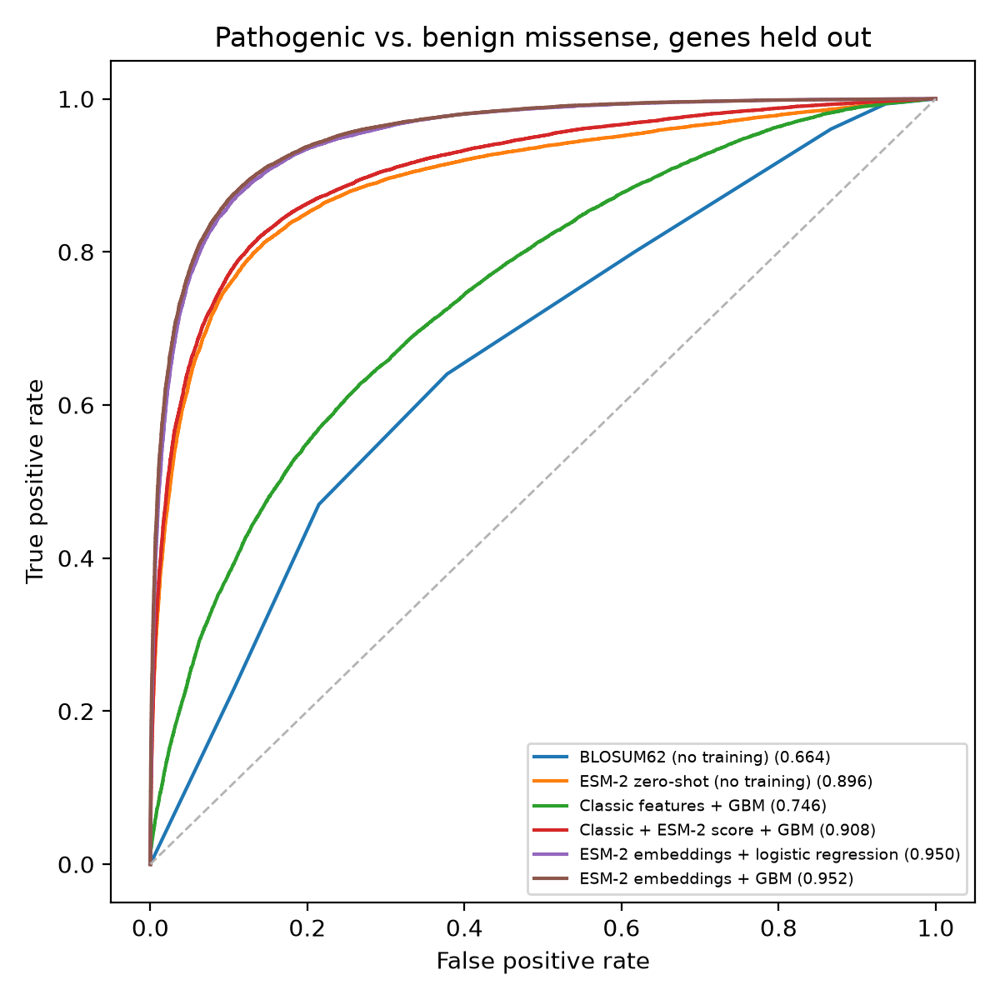

# variant-effect

Predicting whether a missense variant (a single amino-acid change) is pathogenic or benign, using the protein language model ESM-2. On genes never seen in training, embeddings from the 650M-parameter ESM-2 with a gradient-boosted classifier reach **AUROC 0.952**, compared with 0.664 for a BLOSUM62 substitution score.

## Results

66,705 ClinVar missense variants in 7,372 genes (38.1% pathogenic). Every score comes from 5-fold cross-validation where all of a gene's variants stay in the same fold.

| Model | Training | 150M AUROC | 150M AUPRC | 650M AUROC | 650M AUPRC |
| --- | --- | --- | --- | --- | --- |
| BLOSUM62 score | none | 0.664 | 0.507 | 0.664 | 0.507 |
| Classic features + GBM | genes held out | 0.746 | 0.646 | 0.746 | 0.646 |
| ESM-2 zero-shot score | none | 0.837 | 0.816 | 0.896 | 0.866 |
| Classic + ESM-2 score + GBM | genes held out | 0.870 | 0.840 | 0.908 | 0.876 |
| ESM-2 embeddings + logistic regression | genes held out | 0.940 | 0.910 | 0.950 | 0.923 |
| ESM-2 embeddings + GBM | genes held out | 0.942 | 0.915 | 0.952 | 0.929 |
| ESM-2 embeddings + GBM | random split (leaky) | 0.954 | 0.930 | 0.961 | 0.941 |

- The bigger model helps most where nothing is trained: the zero-shot score rises from 0.837 to 0.896. With a classifier trained on top, the gain is smaller (0.942 to 0.952).
- With no labels at all, the 650M zero-shot score (0.896) beats a trained model on classic substitution features (0.746).
- A random split, which lets variants of the same gene appear in both training and test data, inflates the best score to 0.961. Gene-held-out folds give the honest estimate.
- Results are stable across folds: the best models vary by 0.005 to 0.006 AUROC from fold to fold.



ROC curves: `results/roc_esm2_t33_650M_UR50D.png` (650M) and `results/roc_esm2_t30_150M_UR50D.png` (150M). Full metrics are in `results/metrics_<model>.tsv`, and every variant's zero-shot score is in `results/esm_<model>.parquet`.

## Method

1. **Data** (`scripts/build_dataset.py`): ClinVar `variant_summary`, GRCh38 single-nucleotide variants that change one amino acid, reviewed to 2+ stars, labeled (likely) pathogenic or (likely) benign. Each protein is the translation of the variant's RefSeq transcript from NCBI; variants whose reference amino acid doesn't match the protein are dropped (0 here). Genes are hashed into 5 folds.
2. **ESM-2 scoring** (`scripts/esm_score.py`): one forward pass of ESM-2 per protein, at two sizes: `facebook/esm2_t30_150M_UR50D` (150M parameters, 640-value embeddings) and `facebook/esm2_t33_650M_UR50D` (650M parameters, 1,280 values). The zero-shot score is log P(alt) − log P(ref) at the variant's position (wild-type marginals). Proteins over 1,022 residues are cut into overlapping windows (stride 511), and each position is scored from the window where it sits furthest from an edge. The last-layer embedding at each variant's position is saved.
3. **Evaluation** (`scripts/evaluate.py`): baselines (BLOSUM62, Grantham distance, hydrophobicity and volume change, relative position, amino-acid identity) and models trained on them, on the ESM-2 score, and on the embeddings (logistic regression and LightGBM).

## How to run

Requires Python 3.11 (`pip install -r requirements.txt`). Scoring ran on a 16-thread CPU: about 2.4 hours for 150M and 6 hours for 650M. Progress is saved every 250 proteins, so an interrupted run picks up where it stopped. Leave out `--model` to use the 150M model.

```bash
curl -o data/variant_summary.txt.gz https://ftp.ncbi.nlm.nih.gov/pub/clinvar/tab_delimited/variant_summary.txt.gz
python scripts/build_dataset.py --email you@example.org
python scripts/esm_score.py --model facebook/esm2_t33_650M_UR50D
python scripts/evaluate.py --model esm2_t33_650M_UR50D
```

## Limitations

- ClinVar labels are biased toward well-studied genes and toward variants that earlier tools already called, so scores here may run higher than on truly new variants.
- Holding out genes doesn't hold out gene families: a close paralog can still sit in the training folds.
- Only ESM-2 was tried (150M and 650M); the 3B model, ESM-1b and ProtT5 weren't.
- The numbers aren't a direct comparison with published tools, which use different datasets and splits.
